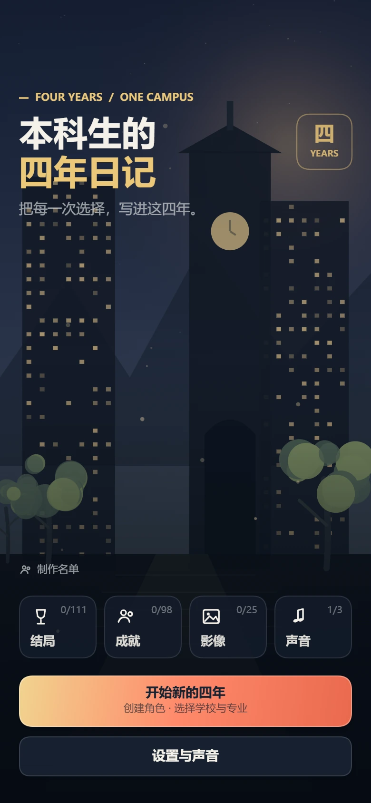
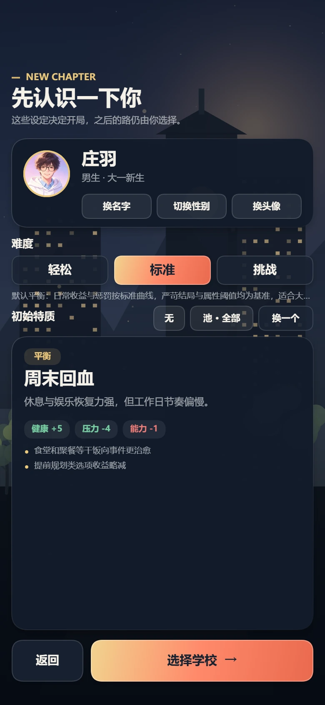
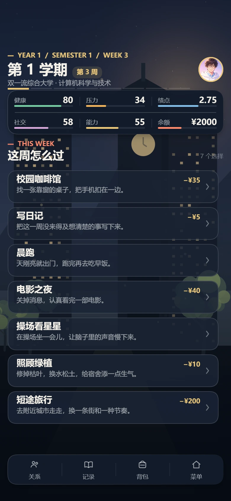
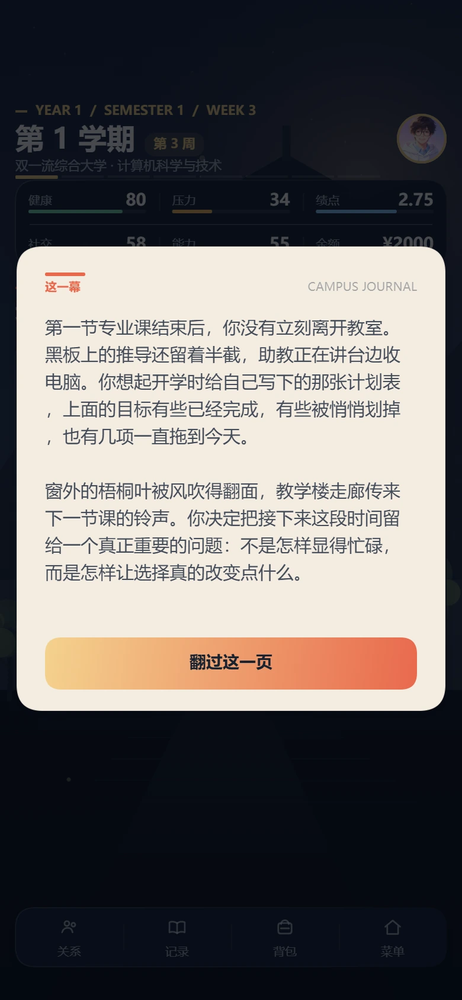
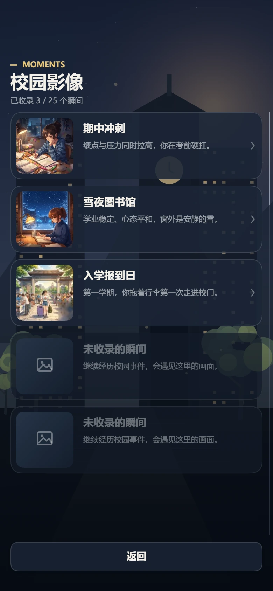
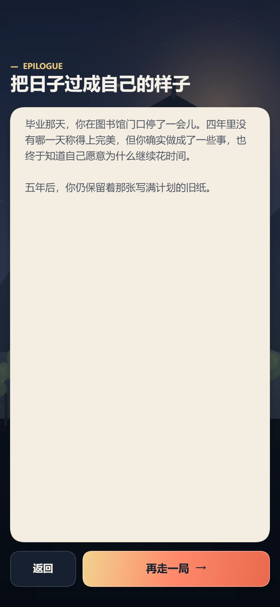

# Undergraduate Simulation

### Four Years, One Campus

A native Canvas + ES Modules WeChat Mini Game about four years of college life. Choose a school and major, plan each week, respond to unexpected events, build relationships, and discover where your choices lead.

[](#)
[](#)
[](#)
[](https://github.com/ZhuangHT-1201/undergraduate-simulation/releases)
[](LICENSE)
[](ASSETS_NOTICE.md)

<p align="center">
  <a href="docs/screenshots/main-menu.webp">
    
  </a>
</p>

<p align="center"><sub>Four years, eight semesters, and every choice that changes direction.</sub></p>

> All schools, characters, and storylines in the game are fictional and are not affiliated with any real institution.

---

## Preview

<p align="center">
  <a href="docs/screenshots/character-creation.webp">
    
  </a>
  <a href="docs/screenshots/weekly-planning.webp">
    
  </a>
</p>

<p align="center">
  <a href="docs/screenshots/story-scene.webp">
    
  </a>
  <a href="docs/screenshots/moment-gallery.webp">
    
  </a>
</p>

<p align="center">
  <a href="docs/screenshots/ending.webp">
    
  </a>
</p>

---

## Highlights

- **A complete four-year run**: eight semesters, weekly actions, semester goals, and milestone events.
- **Readable progression**: GPA, health, pressure, social life, skills, and money shape the journey together.
- **Branching narrative**: school, major, relationships, random events, and player choices unlock different paths and endings.
- **Campus life simulation**: clubs, part-time work, research, internships, civil service, romance, dorm life, and everyday activities.
- **Collection systems**: ending archive, achievements, campus CG gallery, soundtrack collection, and unlockable schools and majors.
- **Mobile-first interaction**: safe-area layouts, touch scrolling, press feedback, haptics, scene transitions, and subtle tap sounds.
- **Native visual presentation**: responsive Canvas scenery, custom icons, and glass surfaces without low-resolution interface overlays.
- **Data-driven content**: events, actions, endings, achievements, characters, and items are maintained through configuration files.

## Play Online

Search for **Undergraduate's Four-Year Diary** in the WeChat Mini Game store. The in-game interface is currently in Simplified Chinese.

> The store title and available version are determined by the WeChat release page.

## Local Development

### Requirements

- [WeChat DevTools](https://developers.weixin.qq.com/miniprogram/dev/devtools/download.html)
- Node.js 18+ (only required for content sync and regression tools)

### Import the Project

1. Clone this repository.
2. Copy the project config template and add your Mini Game AppID:

   ```powershell
   Copy-Item project.config.example.json project.config.json
   ```

3. Open WeChat DevTools, import the repository root, and select **Mini Game** as the project type.
4. Compile and preview in the simulator or on a device.

### Edit Game Content

1. Edit content in `config/v1/*.json`; shared rules live in `config/v1/rules.js`.
2. Sync the JSON files into the runtime catalog:

   ```bash
   node tools/sync-catalog-from-json.mjs
   ```

3. Rebuild the Mini Game in WeChat DevTools.

Useful development scripts:

| Script | Purpose |
| --- | --- |
| `tools/sync-catalog-from-json.mjs` | Sync JSON content into `js/data/catalog.js` |
| `tools/polish-chinese-copy.mjs` | Normalize repeated phrasing and polish Chinese copy |
| `tools/run-sim-regression.mjs` | Run multi-run balance and ending-distribution checks |

## Project Structure

```text
├── game.js                 # Mini Game entry
├── game.json
├── config/v1/              # Rules and game content
├── js/
│   ├── main.js             # Scenes, interaction, main loop, and UI composition
│   ├── core/               # Event engine, saves, achievements, relationships
│   ├── data/catalog.js     # Runtime content catalog
│   ├── ui/                 # Canvas theme, icons, and background rendering
│   └── audio/              # Music and interface sound effects
├── images/                 # CG, avatars, and share assets
├── audio/                  # BGM and tap sound
└── docs/screenshots/       # README screenshots, excluded from the Mini Game bundle
```

## Contributing

Program improvements, compatibility fixes, and bug reports are welcome. Please read [ASSETS_NOTICE.md](ASSETS_NOTICE.md) before using or modifying narrative text, numerical design, images, or audio.

After changing content under `config/v1`, run `node tools/sync-catalog-from-json.mjs` and include the updated `js/data/catalog.js` in your change.

## License

- **Program code**: [MIT License](LICENSE)
- **Narrative, game design data, images, and audio**: [All Rights Reserved](ASSETS_NOTICE.md)

---

## Author

[ZhuangHT-1201](https://github.com/ZhuangHT-1201)
